# SUNLU AMS Heater Auto-Vent Controller - Build Guide

A step-by-step, photo-illustrated guide to assembling an AutoVent and installing it on a SUNLU AMS Heater. Photos are taken from the AutoVent 2.0 build video; each step lists the video timestamp so you can watch that part.

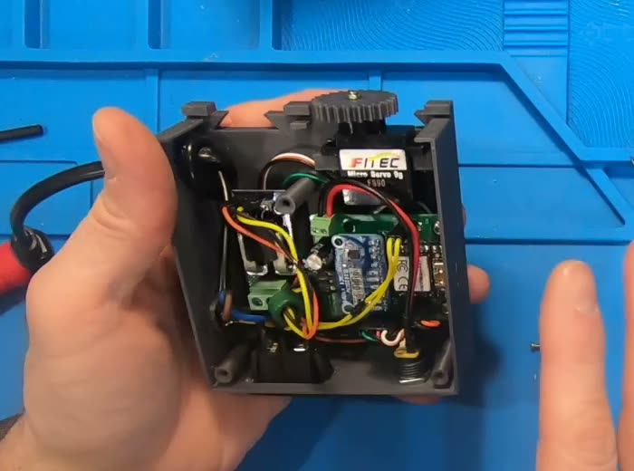

## Table of Contents

1. [Before You Start](#1-before-you-start)
2. [Main Board: XIAO Microcontroller](#2-main-board-xiao-microcontroller)
3. [Main Board: Connector Headers](#3-main-board-connector-headers)
4. [Main Board: ADS1115 and Capacitor](#4-main-board-ads1115-and-capacitor)
5. [Sub-Assemblies: ACS758, Barrel Jack, Button](#5-sub-assemblies-acs758-barrel-jack-button)
6. [Enclosure Assembly](#6-enclosure-assembly)
7. [AC Wiring](#7-ac-wiring)
8. [Low-Voltage Wiring and Closing Up](#8-low-voltage-wiring-and-closing-up)
9. [Installing on the Heater](#9-installing-on-the-heater)
10. [First Power-Up and Learning Mode](#10-first-power-up-and-learning-mode)
11. [Final Checks](#11-final-checks)

---

> ⚠️ **This project switches a mains-powered (120V/240V) appliance.** The AC cord runs through the ACS758 current sensor inside the enclosure. Do all wiring with everything unplugged, insulate every exposed AC joint, and don't plug the unit in until the lid is screwed down. If you're not comfortable wiring mains, buy an assembled unit from [3dcreator.shop](https://3dcreator.shop).

---

## 1. Before You Start

**Video: 0:00 – 2:20**

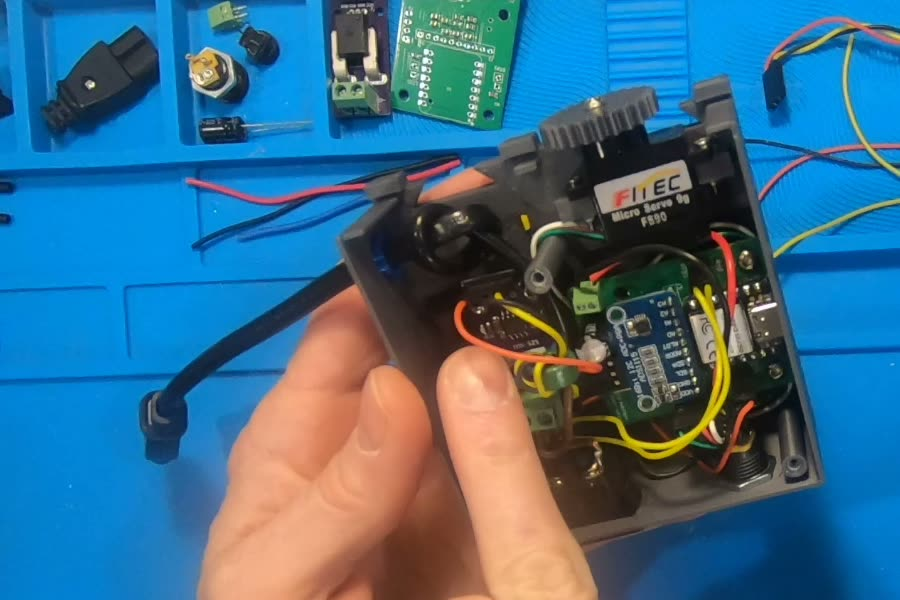

*The finished unit: servo and vent gear at the top, main PCB with the XIAO's USB-C port at the right, ACS758 current sensor board at the left, AC cord entering on the left side and the 5V barrel jack on the right.*

### Parts

The parts list, with quantities and buy links, is the **[Bill of Materials on 3dcreator.shop](https://3dcreator.shop/docs/build-guide)**. The tables below follow it, with corrections for the latest PCB where the BOM is out of date (headers and power adapter). The DIY kit includes everything except the 5V power adapter.

Lay everything out before you start so you're not hunting for parts mid-solder.

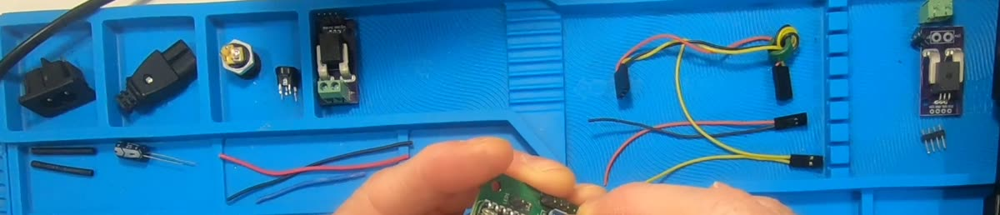

**Electronics**

| Qty | Component | Notes |
|-----|-----------|-------|
| 1 | AutoVent PCB (V2.0) | Included in the DIY kit |
| 1 | Seeed XIAO RP2040 | Main microcontroller |
| 1 | ADS1115 16-bit ADC Module | Analog-to-digital converter |
| 1 | ACS758 Current Sensor Module | 50A Hall-effect sensor |
| 1 | 5V Feedback Servo | 4-lead servo with position feedback |
| 1 | 470µF Electrolytic Capacitor | Power filtering (polarized) |
| 1 | Mini Illuminated Pushbutton | V2.0 lighted power switch (button + status LED). Adafruit 3104 and 3105 are the same button in different colors; either works |
| 1 | C8 Panel Mount Power Inlet | AC power input |
| 1 | C7 Power Cable | AC power cable (pre-assembled) |
| 1 | DC Power Socket for 5V | 5V barrel jack |
| 1 | Data Cable with Ferrite Core | Servo feedback signal (pre-assembled, kit only) |

**Headers, Terminals & Connectors**

| Qty | Component | Notes |
|-----|-----------|-------|
| 2 | 7-pin Headers | XIAO |
| 1 | 10-pin Header | ADS1115 |
| 1 | 4-pin straight header | On the ACS758 module |
| 1 | 3-pin straight header | ACS758 connection on the main PCB |
| 2 | 2-pin Dupont headers | Main PCB: pushbutton and LED |
| 1 | 4-pin straight header | Servo |
| 1 | 2.54mm 2-Position Screw Terminal | PCB 5V power input |
| 1 | 5mm 2-Position Screw Terminal | ACS758 AC connection |
| — | 22 AWG hookup wire | Leads for the 5V socket |
| — | Leads with Dupont connectors | Soldered to the pushbutton and LED; the connector end plugs onto the PCB's 2-pin headers |

> **The BOM's header list is out of date.** All headers are **straight**: a 4-pin on the ACS758 module, a 3-pin for the ACS758 on the main PCB and a 4-pin for the servo, as listed above.

**Not included in the kit**

| Qty | Component | Notes |
|-----|-----------|-------|
| 1 | 5V Power Adapter | Powers the controller. Either a barrel-plug adapter rated over 1A (the BOM lists 2A), **or** a quality 2A USB-C adapter plugged into the XIAO, in which case you can skip the barrel jack. See [Powering the controller](#powering-the-controller) |
| — | 3D printed parts | Enclosure, lid, vent base, vent cover, gear, TPU gaskets. [AutoVent 2.0 on MakerWorld](https://makerworld.com/en/models/2344707-autovent-2-0-for-sunlu-ams-heater#profileId-2563439) (V1 is [here](https://makerworld.com/en/models/2038244-sunlu-ams-heater-autovent#profileId-2198796)). Printed parts and TPU gaskets are also sold at [3dcreator.shop](https://3dcreator.shop) |
| — | M2 screws and nuts | Servo and board mounting |
| — | Heat-shrink tubing | Barrel jack and AC joints |

> The firmware also runs on a Seeed XIAO SAMD21 (same pinout) if you're sourcing your own parts. See [Upload Firmware](README.md#upload-firmware).

### Tools

From the [shop build guide](https://3dcreator.shop/docs/build-guide), plus the extras used in the video:

- Temperature-controlled soldering iron (300–350°C), 60/40 or 63/37 solder and flux
- Flush cutters, wire strippers, needle-nose pliers
- Multimeter (for continuity checks before power-up)
- Small Phillips screwdriver
- Heat gun (for heat-shrink)
- Helping hands or a small vise. The video uses an Omnifixo helping-hands system
- Optional: printed header holders (blue, in the photo below) that hold pin headers upright while you solder a board onto them. These are on MakerWorld

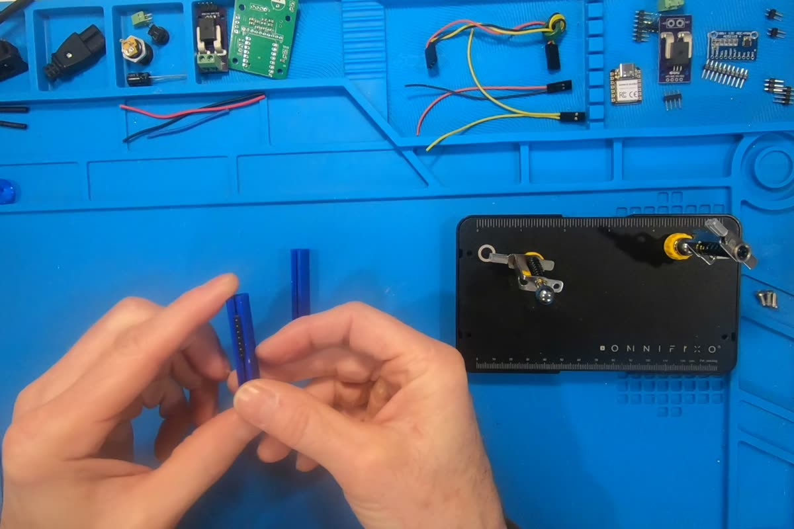

---

## 2. Main Board: XIAO Microcontroller

**Video: 2:20 – 4:15**

1. **Solder the two 7-pin headers to the XIAO.** Stand the header pins in a header holder (or a breadboard), set the XIAO on top and solder every pin. Use flux and take your time, since every joint needs to be good.

   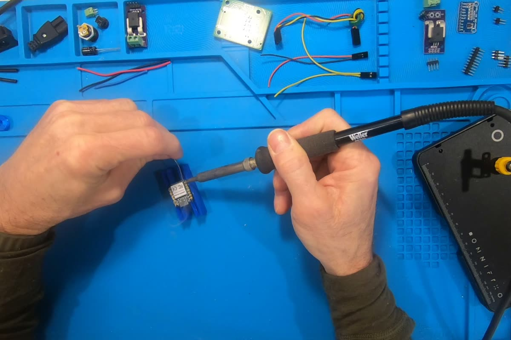

2. **Solder the XIAO directly to the PCB.** Push it down as flush to the PCB as you can, then solder from the underside. You can flash the firmware before or after this step; either works (see [Firmware](#firmware)).

   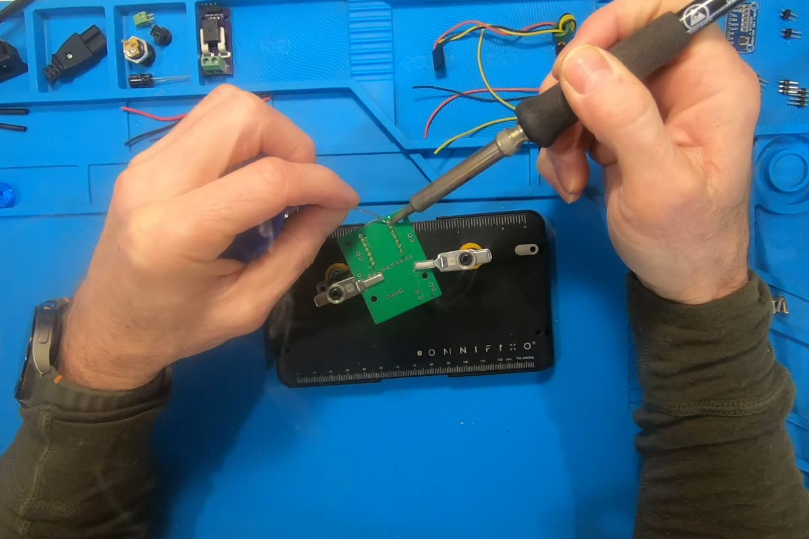

3. **Trim the header pins flush underneath the PCB** with side cutters. Some wires get tucked under the board later, and trimmed pins won't snag them.

   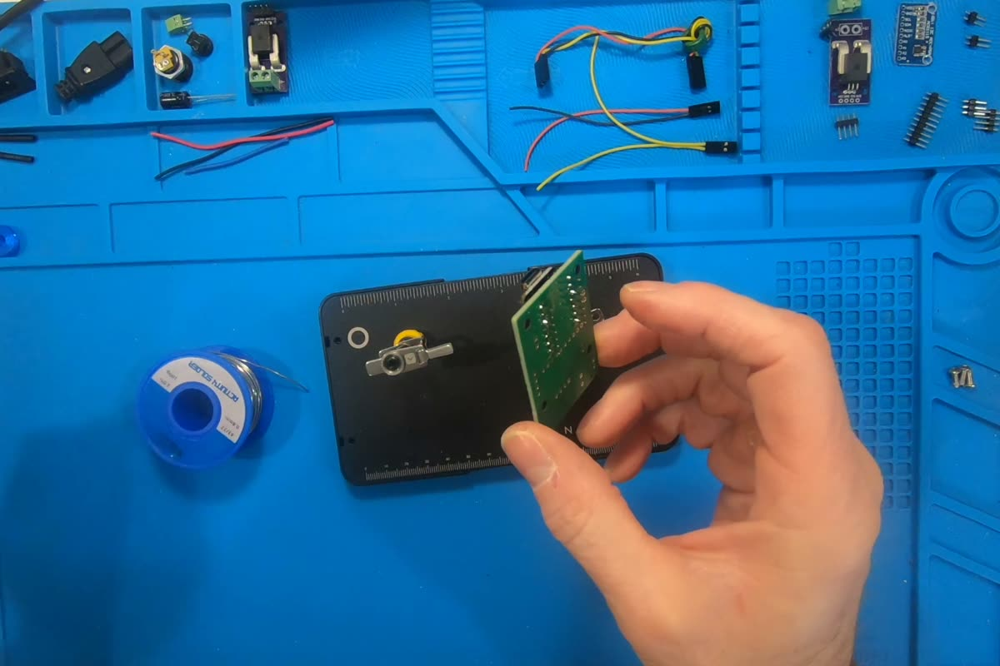

---

## 3. Main Board: Connector Headers

**Video: 4:21 – 6:20**

The main PCB gets these connector headers:

| Header | Location | Connects to |
|--------|----------|-------------|
| 2-pin Dupont (×2) | Top | Pushbutton switch and its LED |
| 4-pin straight | Right side | Servo |
| 3-pin straight | Bottom | ACS758 current sensor (J4) |

All headers are straight. Go by the silkscreen on your board.

> **Option:** instead of a header and cable, you can solder the ACS758 module directly to the PCB with wire leads. See [ACS758 connections](#acs758-connections).

**Orientation:** the **long side of the pins faces away from the board** and the short side goes through the holes. The Dupont connectors plug onto the long side.

**Technique:** seat the header, tack one pin with a little solder, then reheat that joint while you push the header square to the board with your other hand. Once it's at 90°, solder the rest of the pins.

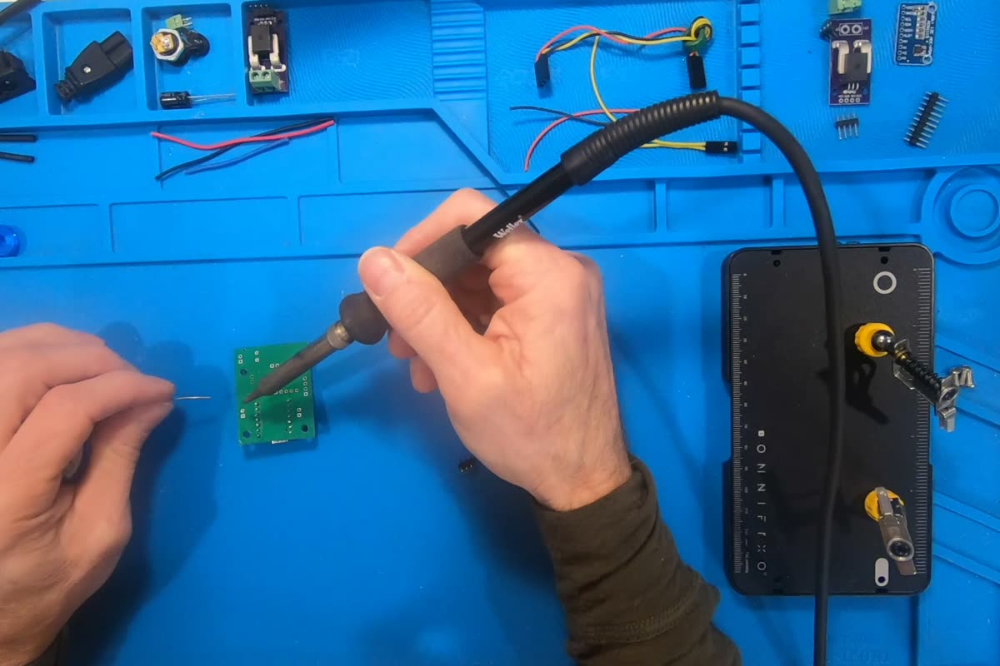

> **On the board in the video, the 3-pin ACS758 header uses the left three holes.** Leave the fourth hole on the right empty. The Rev 2.0 board has only three holes there.

### Connection map

Every connector on the Rev 2.0 PCB and what plugs into it. Square pads are pin 1. Keep this handy for the wiring in sections 5 and 8.

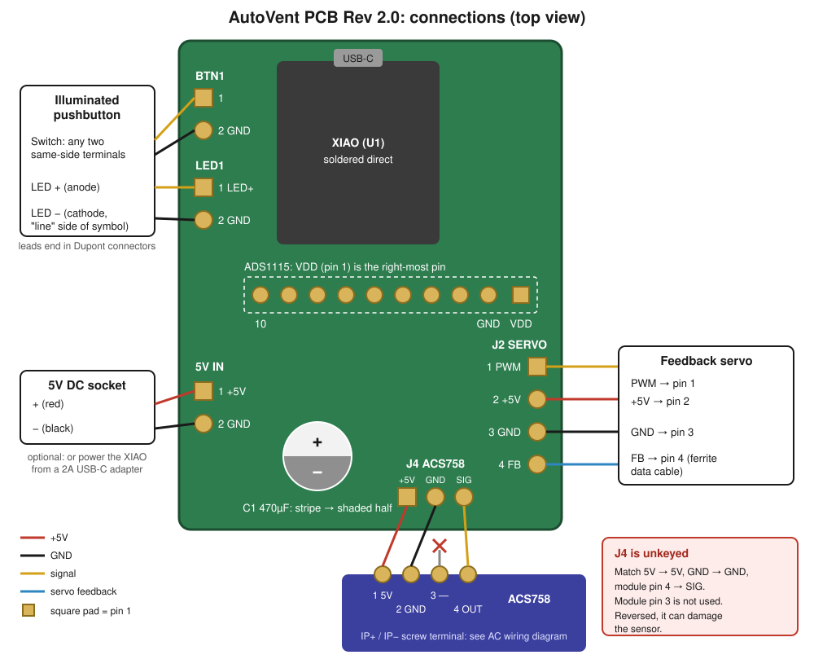

---

## 4. Main Board: ADS1115 and Capacitor

**Video: 8:39 – 11:45**

> The narration calls this board "the ACS" in places, but this step is the **ADS1115** ADC (the blue board), not the ACS758 current sensor.

1. **Solder the 10-pin header to the ADS1115.** Put the header on the underside of the ADS1115 and orient it so that **VCC is the right-most pin**. That way the board fits the footprint and faces away from the XIAO.

   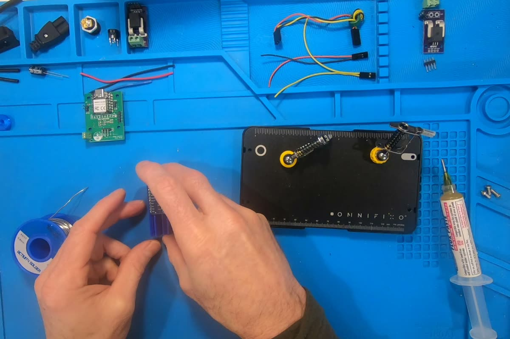

2. **Mount the ADS1115 on the main PCB.** Push it down flat against the PCB and solder from the underside. (The board in the video needed a gap underneath for the ACS758 plug; the latest PCB doesn't.)

   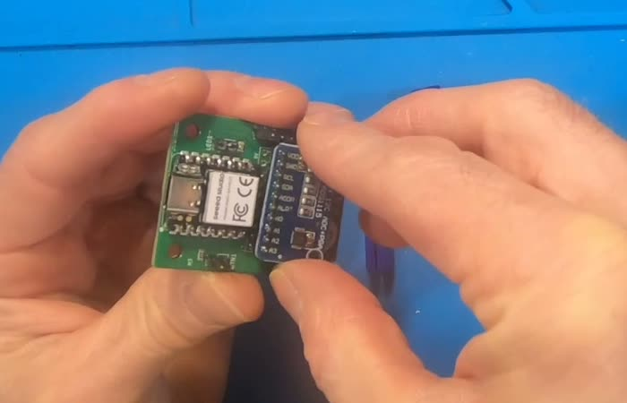

3. **Install the 470µF capacitor.** It's polarized: the negative lead (shorter leg, on the side with the stripe) goes into the **white/shaded half-circle** of the footprint on the silkscreen. Reversing it can damage the capacitor. Splay the leads slightly to hold it, solder from the bottom and clip the leads.

   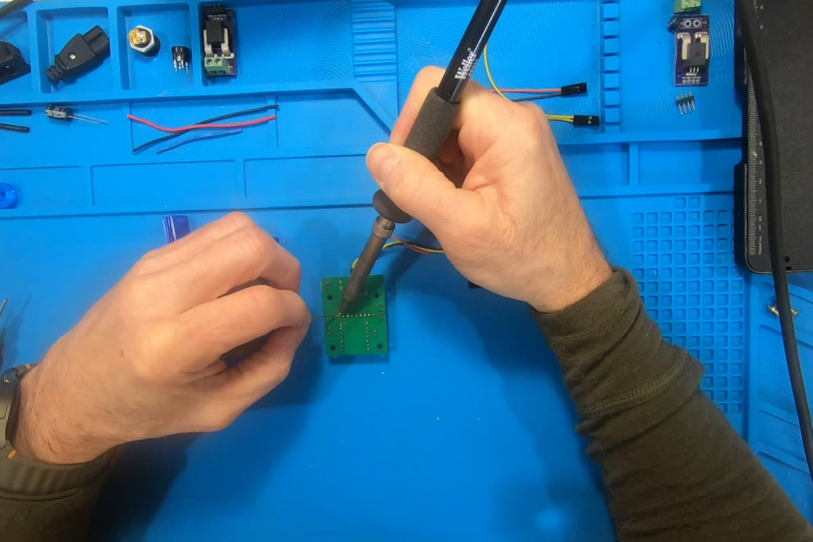

4. **Clean off the flux.** The main board is done.

---

## 5. Sub-Assemblies: ACS758, Barrel Jack, Button

**Video: 11:49 – 14:15**

### ACS758 sensor board

Solder the **4-pin straight header** on one end and the **5mm 2-position screw terminal** on the other, with the terminal's wire openings facing **outward**.

The ACS758 chip can go on the top or the bottom of the board. Top (as shown) makes it easier to route wires underneath the board later.

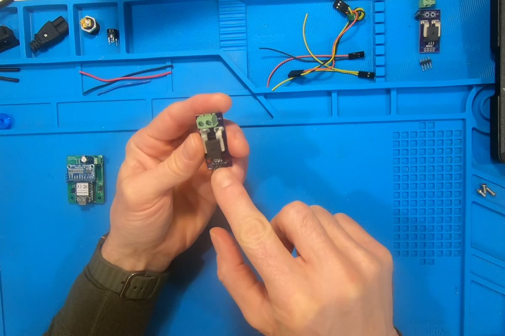

#### ACS758 connections

Only three of the module's four pins are used:

| ACS758 module pin | Connects to (main PCB) |
|-------------------|------------------------|
| 1 | 5V |
| 2 | GND |
| 3 | **Not used** (second data pin, skipped) |
| 4 | Signal |

Check the module's own silkscreen to confirm which end is pin 1 before wiring. You can connect it with a cable from the 4-pin header to the PCB's 3-pin header, or skip the headers and solder the module directly to the PCB with wire leads.

### 5V DC power socket (barrel jack)

> **Optional.** If you'll power the controller from a quality 2A USB-C adapter through the XIAO's USB-C port, you can skip the barrel jack and its leads. See [Powering the controller](#powering-the-controller).

Cut red (+) and black (−) leads from the 22 AWG hookup wire, strip about 3–4mm and tin the ends. Solder them to the socket, matching its + and − markings, then cover the exposed joints with heat-shrink.

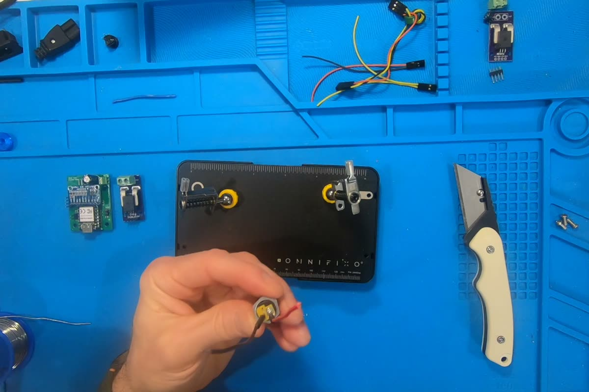

### Mini illuminated pushbutton

The button has six terminals: two for the LED and the rest for the switch.

- **LED cathode (−):** the terminal on the side where the **line** of the power symbol faces outward. This goes to the GND pin of the LED header.
- **LED anode (+):** the terminal directly opposite the cathode.
- **Switch:** any two terminals on the **same side**.

Solder a lead to each terminal of the LED pair and the switch pair. The other end of each lead has a Dupont connector that plugs onto the PCB's 2-pin headers.

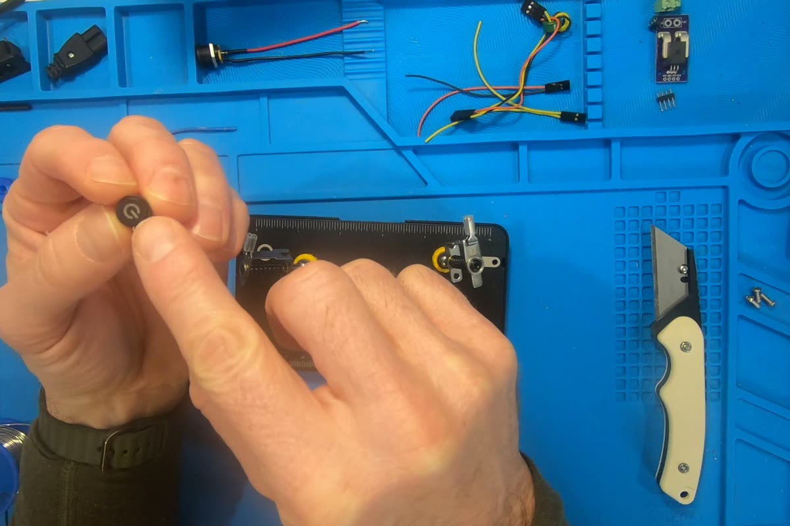

---

## 6. Enclosure Assembly

**Video: 14:18 – 16:10**

1. **Fit the panel parts into the enclosure** (the illuminated pushbutton and the C8 panel-mount power inlet), and push their leads out of the way for now.

2. **Mount the servo** so that:
   - the output gear is offset toward the **center** of the enclosure, and
   - the servo wires exit toward the center.

   Fasten it with **M2 screws** through the posts. Holding the nut with needle-nose pliers while you drive the screw makes this easier.

   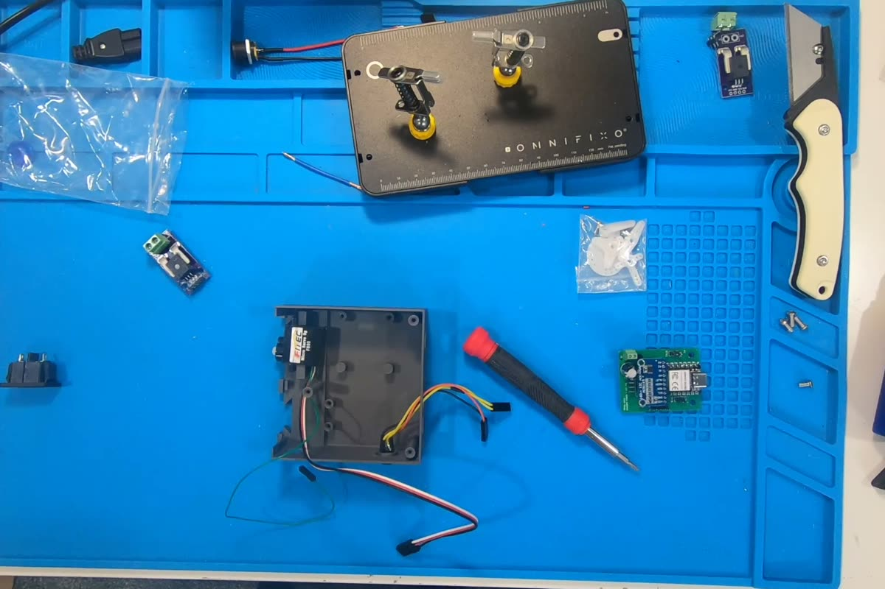

3. **Coil the servo wires under the PCB** and set the PCB in place. One screw is enough for now. How much you route under the board is up to you.

   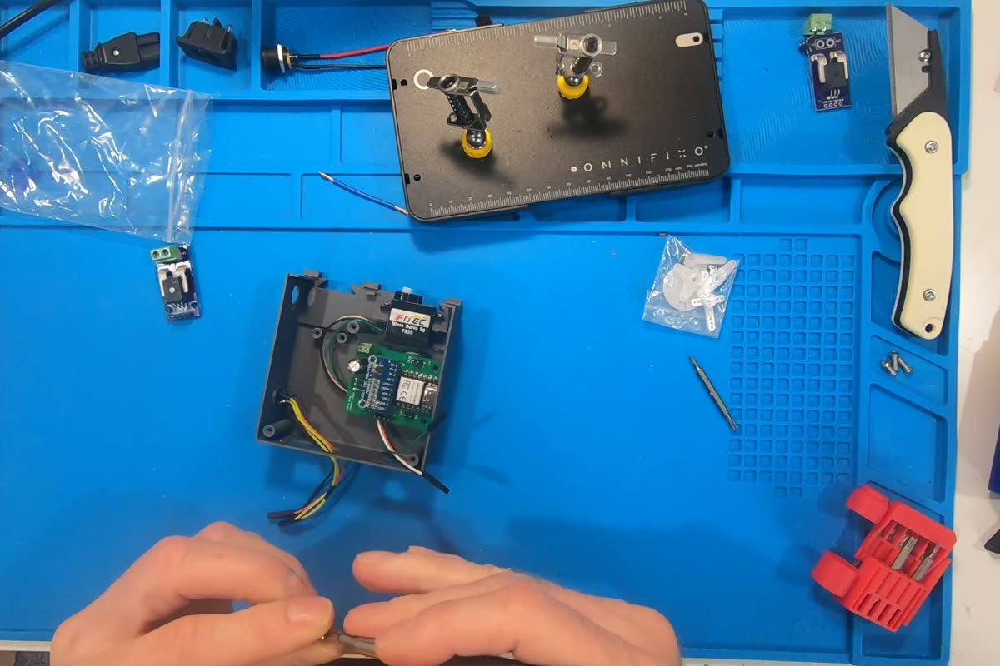

4. **Install the ACS758 board** next to the main PCB with its two screws.

---

## 7. AC Wiring

**Video: 16:11 – 18:50**

> ⚠️ Mains voltage. Everything stays unplugged until the lid is closed.

Use **at least 18 AWG** wire anywhere AC current flows, including the path through the ACS758.

1. **Prepare the C7 power cable.** Strip the outer jacket on the bare end and strip the conductors. Solder leads to the C8 inlet's terminals as needed, and insulate every joint.

   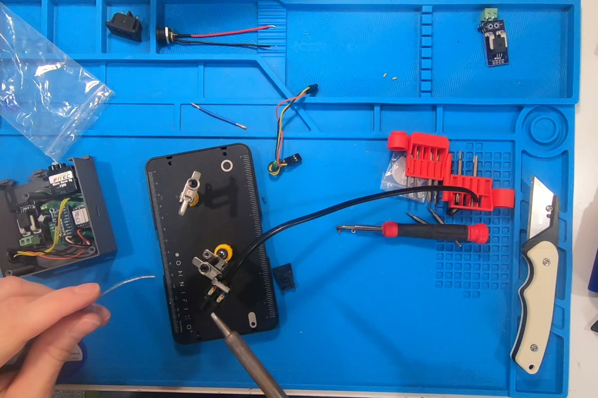

2. **Feed the C7 cable in through the power opening** and tie a **strain-relief knot** just inside the wall so a pull on the cord can't reach the solder joints or terminals. The C7 cable and C8 inlet are two-conductor, so there is no ground wire to connect.

   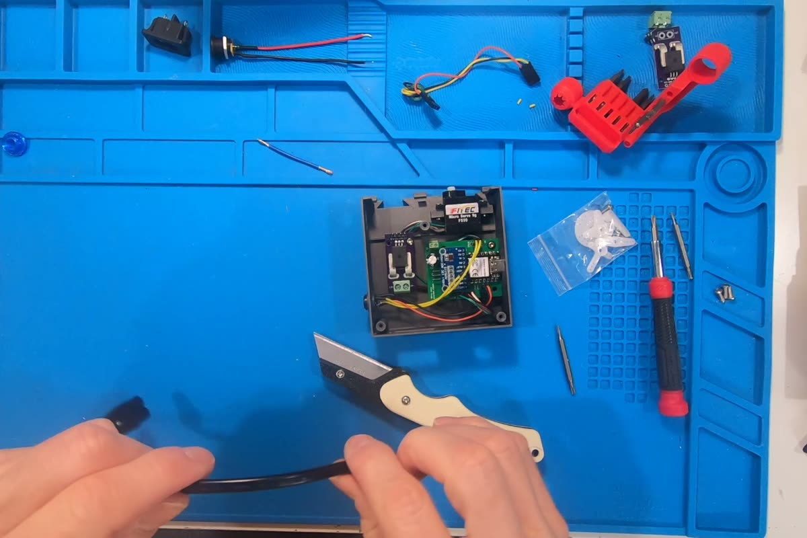

3. **Route one conductor through the current sensor:**
   - Conductor from the C8 inlet → **IP−** on the ACS758 screw terminal
   - **IP+** on the ACS758 → the matching conductor of the C7 cable (going out to the heater)
   - The other conductor runs **straight through** from the C8 inlet to the C7 cable (it doesn't touch the sensor)

   Only one conductor passes through the sensor. If both did, their currents would cancel and the controller would read nothing.

   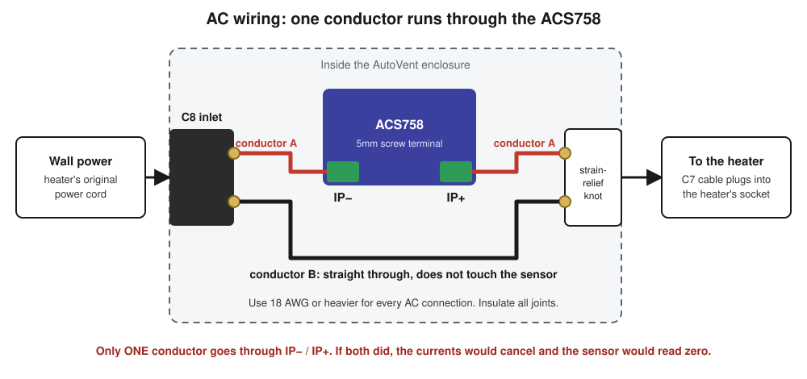

   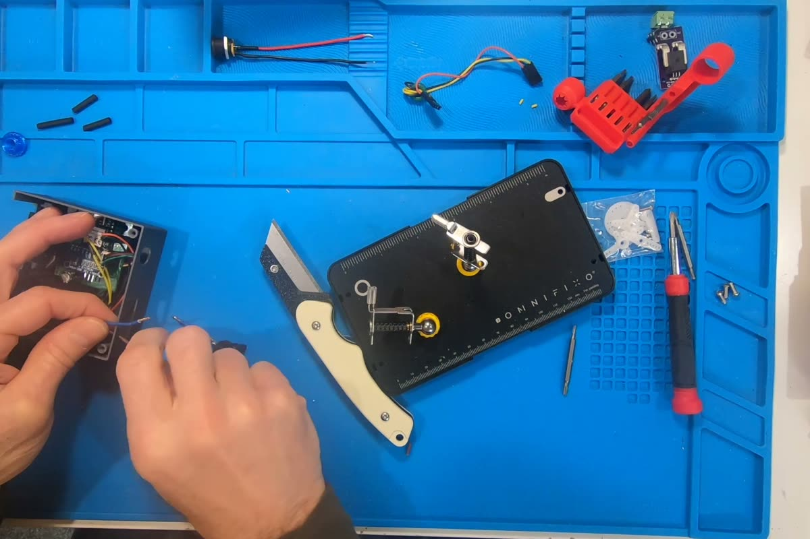

4. **Move the strain-relief knot** to its final position once everything's connected.

---

## 8. Low-Voltage Wiring and Closing Up

**Video: 18:52 – 22:05**

1. **Fit the servo gear.** Press it onto the servo splines and fasten it with the screw that came with the servo.

2. **Connect the ACS758 module to the main PCB's 3-pin header** (J4): **5V to 5V, GND to GND, and the module's 4th pin (signal) to signal.** The module's 3rd pin isn't used (see [ACS758 connections](#acs758-connections)). Follow the labels on both boards. If you chose to solder the module directly to the PCB, make the same three connections with wire leads.

   > ⚠️ **J4 is unkeyed and can be plugged in backwards.** GND is the middle pin, so a reversal swaps 5V with the sensor output. That un-powers the ACS758 and drives 5V into its output pin, which can damage it. Check this connection twice. The boot-time self-test flags a reversed connector (see [Technical Specification §2.2.1](TECHNICAL_SPECIFICATION.md#221-j4-acs_conn-sensor-connector--reversal-hazard)), but don't rely on it.

3. **Install the 5V DC socket** (skip this if you're powering over USB-C). Push it through its hole, put the nut on and tighten. Connect its leads to the main board's 2.54mm 2-position screw terminal (5V IN): **red (+) to pin 1, +5V (square pad)**, and **black (−) to pin 2, GND**. With the board mounted in the enclosure as in the video, that puts ground on top and 5V on the bottom. See the [connection map](#connection-map).

4. **Connect the servo** to the 4-pin header (J2), checking that signal, power and ground line up with the silkscreen. Connect the **button** and **LED** leads to their headers. The kit's **data cable with ferrite core** carries the servo feedback signal; install it with the ferrite core in place.

   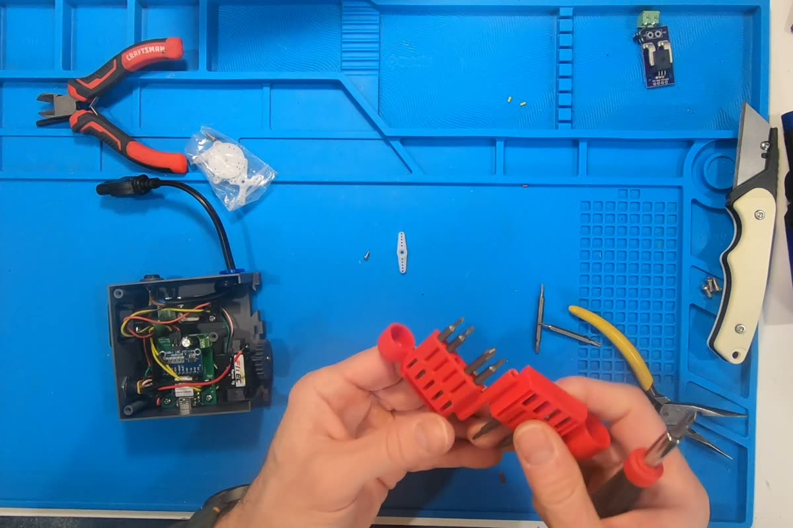

5. **Route and tidy the wires**, add the remaining PCB screw, then put the lid on and screw it down.

---

## 9. Installing on the Heater

**Video: 22:11 – 23:38**

1. **Remove the stock vent cover** from the heater.

   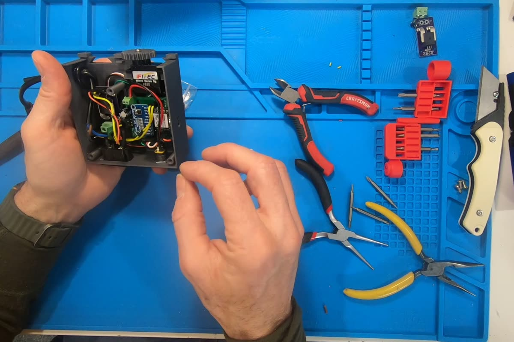

2. **Fit the vent base.** Put its gasket in (it's obvious which gasket goes where), then press the base on so its **outer rim drops down into the recess**. It should be a solid fit.

   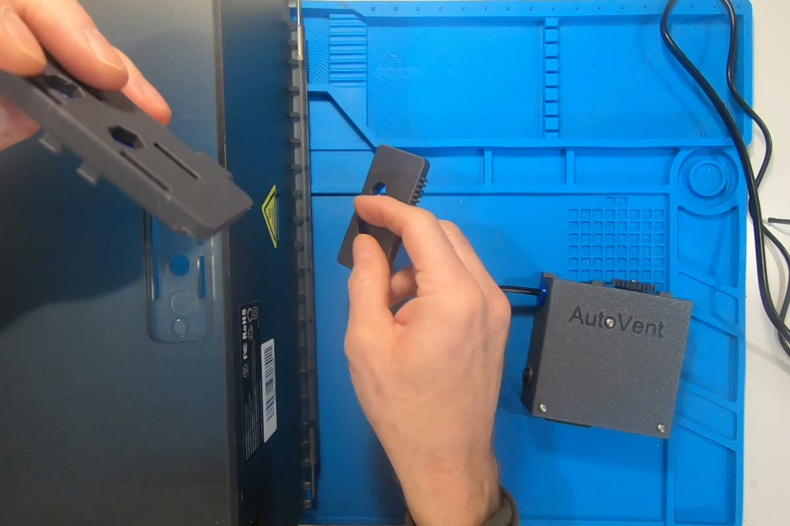

3. **Fit the vent cover** with its TPU gasket installed. It should have a little resistance but still slide easily.

   > **Tip:** a light coat of PTFE spray on the gaskets helps the vent slide smoothly. Let it dry before fitting the cover.

   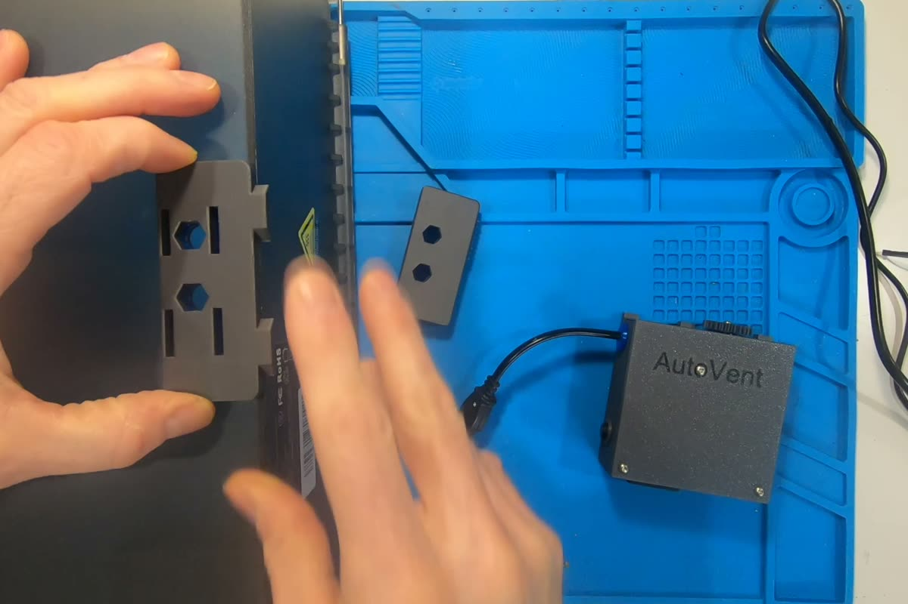

4. **Set the vent to closed**, then **set the servo near the middle of its travel** before meshing the gear. One way: mark where the gear stops at each end, then turn it to roughly halfway between the marks. Then slide the AutoVent on.

   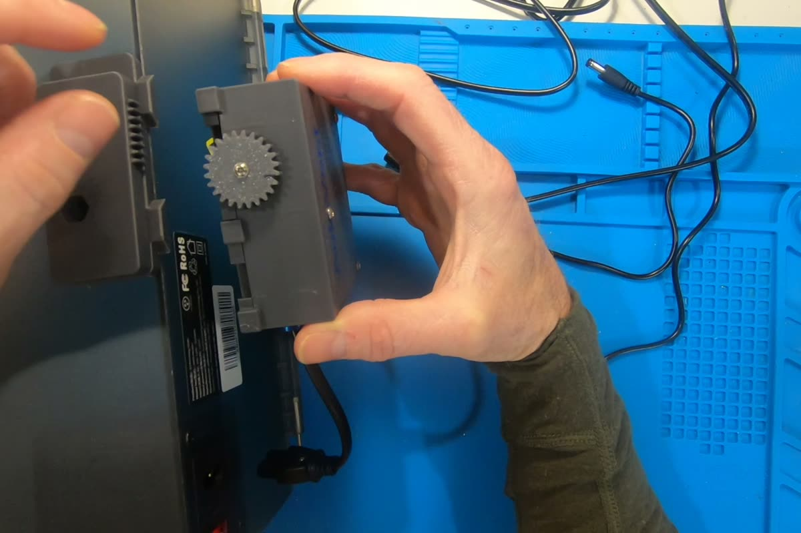

   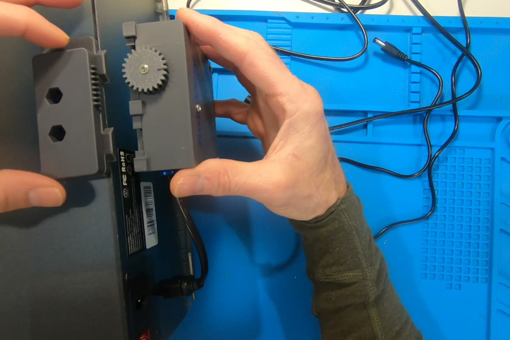

5. **Plug in:** the AutoVent's C7 cable goes into the heater's power socket, the heater's original power cord goes into the AutoVent's C8 inlet and then to the wall, and the 5V adapter goes into the 5V DC socket (or a USB-C adapter goes into the XIAO).

   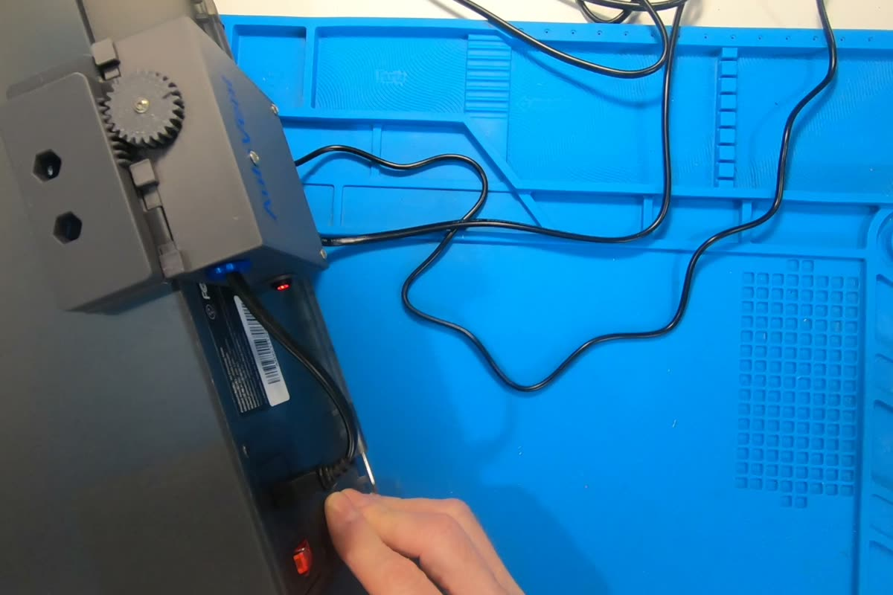

---

## 10. First Power-Up and Learning Mode

**Video: 23:38 – 26:00**

### Firmware

If your XIAO isn't already flashed, see [Upload Firmware](README.md#upload-firmware). The easiest route is to drag the matching UF2 file onto the board in bootloader mode. Pick **v1 or v2** to match your printed parts; the two designs drive the vent in opposite directions.

### First power-up

Before the first power-up, use a multimeter to confirm there's no short between 5V and GND, as the [shop build guide](https://3dcreator.shop/docs/build-guide) recommends.

#### Powering the controller

Use either option:

| Option | Adapter | Notes |
|--------|---------|-------|
| Barrel jack | 5V, rated over 1A (the BOM lists 2A) | Plugs into the 5V DC socket |
| USB-C | Quality 5V **2A** USB-C adapter | Plugs into the XIAO's USB-C port. The barrel jack isn't needed |

A cheap or weak USB-C adapter can sag when the servo moves, so use a good one.

On the very first boot the controller **finds the vent's stops automatically** and saves the servo travel limits. The LED flashes while the vent moves slowly to each end, then goes **solid** when it's ready (about 20–30 seconds extra on first boot; later boots take about 10 seconds).

If the LED **double-blinks** instead, the automatic setup failed and the vent won't move until the limits are set. Set them by hand with Jog Mode (below).

### Setting the servo limits by hand (Jog Mode)

Use Jog Mode if Auto Find failed (LED double-blinks, status shows `SERVO NOT SET UP`), or if the vent strains at either end or doesn't fully close or open. Jog Mode stops the servo just short of each hard stop so it never stalls there. Automatic vent control and the button are paused while you jog.

Connect over USB-C and open the [Serial Monitor app](SerialMonitor/README.md), then:

1. Click **Jog Mode** (or send `J`).
2. Step toward the **closed** end with **+1° / −1°** (`+` / `-`) or **+5° / −5°** (`>` / `<`) until the vent stops moving. A warning prints when the feedback stops following.
3. **Back off about 10–15°** from that stop, then click **Set Closed** (`C`).
4. Do the same at the **open** end and click **Set Open** (`O`).
5. Click **Save** (`W`). The controller checks the new limits and returns to automatic control.

**Cancel** (`Q`) leaves without changing anything. **Defaults** (`D`) deletes the saved limits, so the next calibration runs Auto Find again. Saved limits survive power loss.

You can also re-run the automatic search at any time with **Auto Find** (`A`), then **Save** (`W`). Full details are in [Servo Setup](USER_GUIDE.md#servo-setup).

### Learning mode

Teach the controller your heater's current signature. Start with the heater's main switch on but the heater and fan **off**.

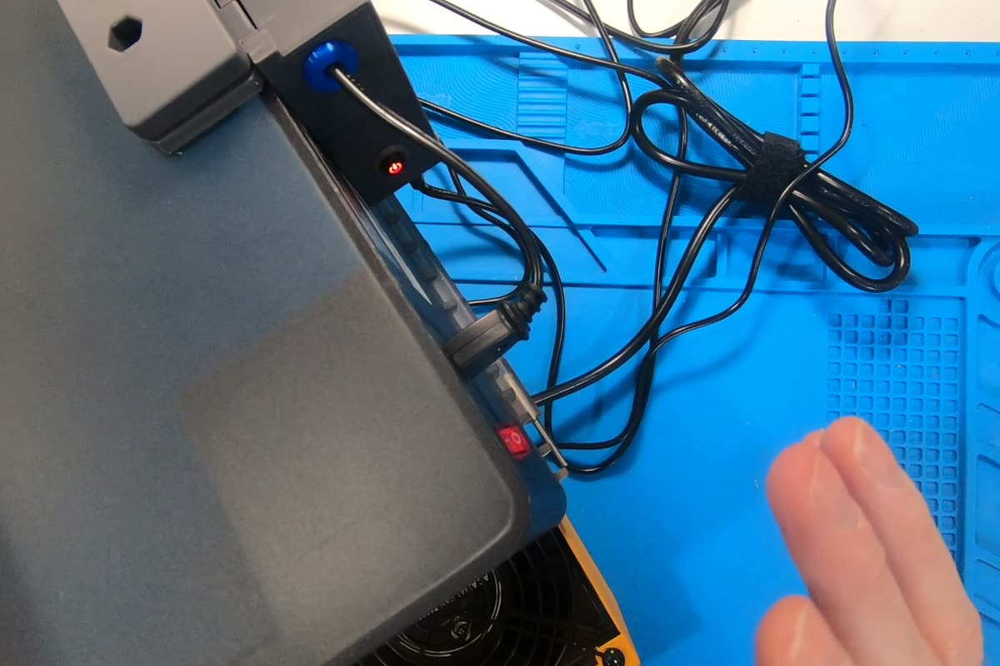

1. **Hold the button** until the LED goes **out** (about 2 seconds) and comes back **on** (about 5 seconds), then release.
2. **LED solid:** heater and fan are off. **Press once.** The LED flashes while it measures the baseline (about 10 seconds).
3. **LED solid:** turn the **heater and fan on**. **Press once.** It flashes while measuring.
4. **LED solid:** turn the **heat off** from the front panel so only the fan runs. **Press once.** It flashes while measuring.
5. **3 long blinks**, then solid: done. The thresholds are saved to flash.

Repeat learning mode whenever you move the AutoVent to a different heater or change components. Full details are in the [User Guide](USER_GUIDE.md#5-learning-mode).

---

## 11. Final Checks

With learning complete, verify normal operation:

| Do this | Vent should |
|---------|-------------|
| Turn the heater on | **Open** |
| Turn the heat off, fan still running | **Stay open**, then close after 3 minutes if the fan is still running |
| Turn the heater fully off (heat and fan) | **Close right away** |

If something doesn't behave, see [Troubleshooting](USER_GUIDE.md#7-troubleshooting). The [Serial Monitor app](SerialMonitor/README.md) shows live current readings and the controller's state, which makes problems much easier to diagnose.

---

**PCBs and Kits Available**: [3dcreator.shop](https://3dcreator.shop)
**Open Source Repository**: [github.com/kgregg384/SUNLU_AMS_Heater_AutoVent](https://github.com/kgregg384/SUNLU_AMS_Heater_AutoVent)
